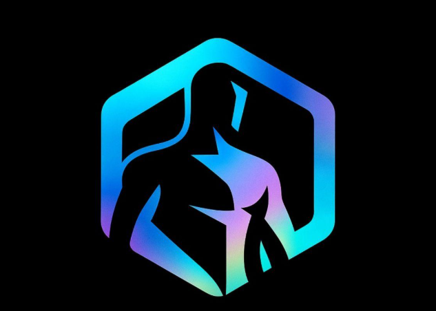

   
  <b>CALIVISION</b>

# CALIVISION

Aplicativo de **calistenia validada por câmera**. O usuário não marca exercício como feito: a câmera acompanha o corpo e só conta a repetição quando o movimento completo é reconhecido.

> Projeto em desenvolvimento (fases 1 a 4). Funciona no computador, com webcam. Ainda não há interface gráfica completa nem versão Android.

## Como funciona

1. O MediaPipe Pose encontra as articulações do corpo em cada quadro da câmera.
2. O programa calcula o ângulo da articulação principal (cotovelo ou joelho).
3. Uma máquina de estados acompanha o ciclo: posição inicial → descida → fundo → subida → retorno.
4. A repetição só é contada se o ciclo foi completo. Movimento incompleto é rejeitado e o motivo fica registrado no banco.
5. A prancha é validada por tempo: só soma segundos com o corpo alinhado e visível.

## Exercícios

| Exercício | Tipo | Critério (valores iniciais, ainda a calibrar) |
|---|---|---|
| Flexão | repetições | cotovelo ≤ 90° embaixo, ≥ 155° em cima, corpo alinhado |
| Paralelas (mergulho) | repetições | cotovelo ≤ 90° embaixo, ≥ 155° em cima |
| Prancha | tempo | ombro-quadril-tornozelo ≥ 165° |
| Agachamento | repetições | joelho ≤ 100° embaixo, ≥ 160° em cima |

## Instalação

Python 3.10 ou 3.11 recomendado.

    git clone <URL-DO-SEU-REPOSITORIO>
    cd calivision
    python -m venv .venv
    source .venv/bin/activate        # Windows: .venv\Scripts\activate
    pip install -r requirements.txt

## Uso

Interface gráfica (recomendado):

    python main.py

Cadastre-se na tela inicial, escolha o exercício, as séries e a meta, e inicie. Pelo terminal (alternativa):

    python main.py cadastrar "Seu Nome" voce@email.com
    python main.py treinar voce@email.com --exercicio flexao --series 3 --reps 10
    python main.py treinar voce@email.com --exercicio prancha --series 3 --reps 30   # reps = segundos

Teclas: `p` pausa, `q` encerra.

**Posição da câmera:** de lado, na altura do quadril, a cerca de 2 m, corpo inteiro visível e boa iluminação. Câmera de frente prejudica a medição do cotovelo e do joelho.

## Testes

Rodam sem câmera, com ângulos simulados:

    pytest

## Estrutura

    main.py                  linha de comando e loop da câmera
    assets/logo.png          logo do aplicativo
    calivision/ui/           interface gráfica (PySide6): login, início, treino
    calivision/sessao.py     liga o corpo detectado ao validador do exercício
    calivision/abertura.py   tela de abertura (logo + nome)
    calivision/geometria.py  cálculo de ângulos
    calivision/validador.py  máquina de estados (repetições) e validador de prancha
    calivision/pose.py       integração com o MediaPipe
    calivision/banco.py      SQLite, cadastro e login
    tests/                   testes automatizados

## Privacidade

- Processamento local. Nenhuma imagem é enviada para servidor.
- Vídeo não é gravado.
- Dados (usuário, treinos, repetições) ficam em `~/.calivision/calivision.db`.
- Senhas são guardadas com hash PBKDF2 e sal.

## Limitações

- A estimativa de pose em 2D erra mais com o corpo deitado, braços ou pernas escondidos e pouca luz.
- Os limites de ângulo são valores iniciais e precisam de calibração com testes reais.
- O sistema pode ser enganado por movimentos que imitam o ciclo. Ele dificulta a trapaça, mas não a elimina.
- A análise não garante execução correta nem ausência de lesão. Em caso de dor, pare e procure um profissional.

## Próximos passos

- Calibrar flexão, paralelas e prancha com testes reais.
- Interface gráfica (PySide6).
- Estatísticas e gráficos de progresso.
- Barra fixa (exige calibração da altura da barra).
- Versão para navegador ou Android.
